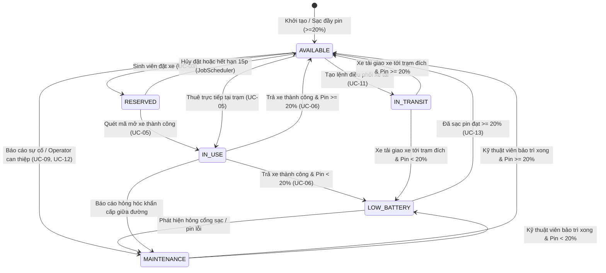
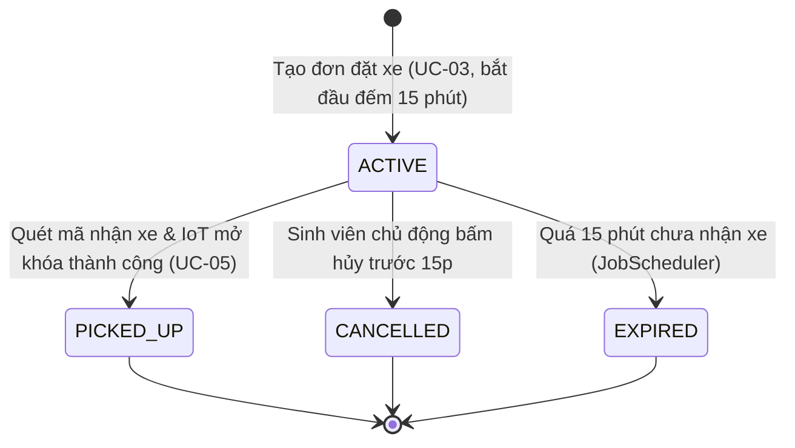
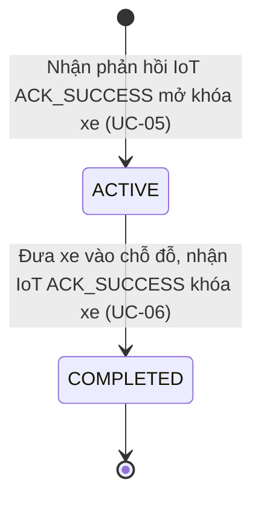

# 01 — Domain Rules & State Machines

Tài liệu này chuẩn hóa toàn bộ các quy tắc nghiệp vụ (Business Rules), máy trạng thái (State Machines), ngưỡng số học (Thresholds), các giá trị Enum hợp lệ và các quy tắc an toàn khi xử lý dữ liệu bất thường.

---

## 1. Danh Mục Giá Trị Enum Hợp Lệ (Approved Enums)

Mọi thành phần (Backend Domain, DTO, Frontend UI, Simulator) **bắt buộc phải dùng chính xác các giá trị enum này (phân biệt hoa thường - Case Sensitive)**. Không được tự ý định nghĩa thêm các giá trị ngoài danh sách:

| Tên Enum | Các giá trị hợp lệ | Giải thích nghiệp vụ |
|---|---|---|
| `VehicleStatus` | `AVAILABLE` `RESERVED` `IN_USE` `IN_TRANSIT` `LOW_BATTERY` `MAINTENANCE` | • `AVAILABLE`: Sẵn sàng cho thuê (pin $\ge 20\%$, telemetry `FRESH`). • `RESERVED`: Đang được sinh viên giữ chỗ (tối đa 15p). • `IN_USE`: Đang trong chuyến đi (mở khóa thành công). • `IN_TRANSIT`: Đang được xe tải chuyển trạm theo lệnh điều phối. • `LOW_BATTERY`: Pin cạn dưới $20\%$, ưu tiên sạc, cấm cho thuê. • `MAINTENANCE`: Đang hỏng hoặc có sự cố, rút khỏi mạng lưới. |
| `ParkingSpaceStatus` | `AVAILABLE` `RESERVED` `OCCUPIED` | • `AVAILABLE`: Ô đỗ trống, có thể đặt trước hoặc đỗ xe vào. • `RESERVED`: Đã có người đặt trước trong khung giờ sắp tới. • `OCCUPIED`: Đang có xe đỗ tại chỗ. |
| `ChargingPortStatus` | `AVAILABLE` `SCHEDULED` `CHARGING` `MAINTENANCE` | • `AVAILABLE`: Cổng sạc rảnh rỗi. • `SCHEDULED`: Đã được xếp lịch cho một yêu cầu sạc. • `CHARGING`: Đang truyền tải điện sạc vào xe. • `MAINTENANCE`: Cổng sạc hỏng hoặc ngắt do bảo trì. |
| `ReservationStatus` | `ACTIVE` `CANCELLED` `EXPIRED` `PICKED_UP` | • `ACTIVE`: Đang giữ chỗ trong thời hạn 15 phút. • `CANCELLED`: Sinh viên tự hủy giữ chỗ trước giờ. • `EXPIRED`: Quá 15 phút không đến nhận, hệ thống tự giải phóng. • `PICKED_UP`: Đã quét mã mở xe thành công và chuyển sang Ride. |
| `RideStatus` | `ACTIVE` `COMPLETED` | • `ACTIVE`: Chuyến đi đang diễn ra. • `COMPLETED`: Đã trả xe và khóa xe thành công tại Hub đích. |
| `AccountRole` | `STUDENT` `OPERATOR` | • `STUDENT`: Sinh viên di chuyển trong khuôn viên. • `OPERATOR`: Nhân viên quản lý vận hành mạng lưới. |
| `AccountStatus` | `ACTIVE` `SUSPENDED` `UNVERIFIED` | • `ACTIVE`: Hoạt động bình thường. • `SUSPENDED`: Bị khóa do vi phạm hoặc chưa trả nợ cước. • `UNVERIFIED`: Chưa xác thực email trường. |
| `CommandStatus` | `PENDING` `ACKNOWLEDGED` `FAILED` `AWAITING_RECONCILIATION` | • `PENDING`: Đang gửi lệnh tới thiết bị IoT. • `ACKNOWLEDGED`: Thiết bị phản hồi thực thi thành công. • `FAILED`: Thiết bị phản hồi lỗi hoặc timeout. • `AWAITING_RECONCILIATION`: Trạng thái chưa rõ, cần kiểm tra đối soát. |
| `AlertSeverity` | `NORMAL` `WARNING` `CRITICAL` `MISSING_DATA` | • `NORMAL`: Trạm hoạt động cân bằng. • `WARNING`: Trạm có nguy cơ đầy chỗ hoặc sắp thiếu xe. • `CRITICAL`: Trạm quá tải $\ge 85\%$ hoặc hết sạch xe. • `MISSING_DATA`: Trạm mất kết nối cảm biến/dữ liệu đo xa. |
| `DataQuality` | `FRESH` `STALE` `MISSING` | • `FRESH`: Dữ liệu nhận trong $\le 10$ phút gần nhất. • `STALE`: Dữ liệu quá hạn $> 10$ phút. • `MISSING`: Hoàn toàn không có dữ liệu đo xa. |

---

## 2. Các Ngưỡng Số Học & Hằng Số Nghiệp Vụ (Threshold Constants)

Mọi ngưỡng nghiệp vụ dưới đây được xem là **bất biến (invariants)** và phải được cấu hình tập trung:

1. **Ngưỡng pin tối thiểu cho thuê (`MIN_RENTABLE_BATTERY_PCT = 20.0%`):**
   - Xe chia sẻ có `batteryPct < 20.0%` tuyệt đối không được phép cho thuê hoặc đặt trước.
   - Lý do: Đảm bảo xe đủ năng lượng hoàn thành ít nhất 1 chặng di chuyển an toàn giữa hai điểm xa nhất trong khuôn viên VNU-HCM mà không chết máy giữa đường.
2. **Thời hạn giữ chỗ (`HOLD_TIMEOUT_MINUTES = 15 phút`):**
   - Khi sinh viên đặt trước xe (UC-03) hoặc đặt chỗ đỗ (UC-04), hệ thống giữ xe/chỗ trong đúng 15 phút (UC-03: holdUntil tính từ lúc tạo lượt đặt xe. UC-04: holdDeadline tính từ giờ hẹn).
   - Nếu quá thời hạn mà sinh viên chưa quét mã nhận xe hoặc chưa đỗ vào chỗ, hệ thống tự động đổi trạng thái sang `EXPIRED` và hoàn trả xe/chỗ đỗ về `AVAILABLE`.
3. **Ngưỡng cảnh báo quá tải trạm (`OVERLOAD_OCCUPANCY_THRESHOLD = 85.0%`):**
   - Tỷ lệ chiếm dụng chỗ đỗ tại một Hub = `(occupiedSpaces / totalSpaces) * 100%`.
   - Nếu tỷ lệ $\ge 85.0\%$, kích hoạt cảnh báo `CRITICAL` (nguy cơ sinh viên không còn chỗ trả xe).
4. **Ngưỡng cảnh báo thiếu hụt xe (`LOW_VEHICLE_THRESHOLD = 2 xe`):**
   - Nếu một trạm có số xe chia sẻ sẵn sàng phục vụ $\le 2$ xe, phát tín hiệu cảnh báo `WARNING` hoặc `CRITICAL` yêu cầu xe tải luân chuyển tiếp tế.
5. **Thời hạn dữ liệu đo xa còn mới (`TELEMETRY_FRESHNESS_LIMIT = 10 phút`):**
   - Tọa độ và trạng thái pin của xe chỉ được xem là tin cậy nếu thời điểm ghi nhận (`observedAt`) cách thời điểm kiểm tra không quá 10 phút.
6. **Thời lượng phiên đăng nhập (`SESSION_EXPIRY_MINUTES = 30 phút`):**
   - Token phiên làm việc của Sinh viên và Operator hết hạn sau 30 phút không hoạt động.

---

## 3. Máy Trạng Thái Của Các Thực Thể (State Machines)

### 3.1. Vòng đời Xe (Vehicle State Machine)

### 3.2. Vòng đời Đặt trước Xe (Reservation State Machine)

### 3.3. Vòng đời Chuyến đi (Ride State Machine)

---

## 4. Các Quy Tắc Nghiệp Vụ Cốt Lõi Chi Tiết (Detailed Business Rules)

### BR-01: Điều kiện hợp lệ để xe có thể cho thuê / đặt trước
Một phương tiện chỉ được phép hiển thị cho sinh viên tìm kiếm (UC-01) hoặc chấp nhận đặt trước (UC-03) khi và chỉ khi thỏa mãn **toàn bộ** các điều kiện sau:
1. `ownership == SHARED` (Không phải xe cá nhân của người khác).
2. `status == AVAILABLE`.
3. `batteryPct >= 20.0` (Đủ dung lượng pin tối thiểu).
4. `telemetry.quality == FRESH` (Dữ liệu tọa độ và trạng thái pin được cập nhật trong vòng 10 phút gần nhất).

### BR-02: Giới hạn số lượng giao dịch hoạt động của Sinh viên
- Một tài khoản Sinh viên tại một thời điểm **chỉ được phép có tối đa 01 lượt đặt xe (`Reservation` có status `ACTIVE`) HOẶC 01 chuyến đi (`Ride` có status `ACTIVE`)**.
- Không cho phép sinh viên đặt nhiều xe cùng lúc để đầu cơ giữ xe.
- Khi sinh viên đang có 1 chuyến đi chưa hoàn tất, từ chối mọi yêu cầu đặt xe mới (`409 Conflict`).

### BR-02A: Khung thời gian thuê yêu cầu trong UC-03
- Request đặt xe phải cung cấp `startAt` (thời điểm bắt đầu thuê dự kiến) và `endAt` (thời điểm dự kiến trả xe).
- Cả hai là Instant theo ISO-8601 UTC; `endAt` bắt buộc sau `startAt`. Thiếu mốc hoặc `endAt <= startAt` bị từ chối là `400 Bad Request`.
- Đây là khung thời gian người dùng yêu cầu, không thay cho thời điểm thực tế bắt đầu/kết thúc chuyến đi do IoT xác nhận trong UC-05/UC-06 và không ảnh hưởng hạn giữ chỗ 15 phút.

### BR-03: Xử lý Pin khi Kết thúc Chuyến đi (Return Ride)
- Khi sinh viên trả xe tại Hub đích (UC-06):
  - Đối chiếu ACK khóa với commandId, xe và ô đỗ. Khi thiếu pin cuối, giữ chuyến chưa hoàn tất để đối soát. Có báo sự cố thì ưu tiên MAINTENANCE. Các ngưỡng sau áp dụng khi pin hợp lệ và không có sự cố.
  - Nếu `finalBatteryPct < 20.0`: Trạng thái xe **BẮT BUỘC** chuyển sang `LOW_BATTERY`. Xe tự động được đưa vào hàng đợi ưu tiên sạc (UC-13) và không hiển thị cho sinh viên khác thuê.
  - Nếu `finalBatteryPct >= 20.0`: Trạng thái xe chuyển sang `AVAILABLE`.

### BR-04: Đặt trước Chỗ đỗ xe (Parking Space Reservation)
- Sinh viên có thể đặt trước ô đỗ xe tại trạm đích trước khi di chuyển đến.
- Hệ thống kiểm tra khoảng thời gian `[startAt, endAt)`:
  - Không được trùng lặp (overlap) với bất kỳ đơn đặt chỗ nào khác trên cùng `spaceId`.
  - Ô đỗ phải có `status == AVAILABLE`.
- Hạn giữ ô đỗ là 15 phút kể từ thời điểm `startAt`. Sau 15 phút nếu xe chưa vào ô, đơn tự động hủy (`EXPIRED`).

### BR-05: Lệnh Mở khóa / Khóa xe và Xử lý Bất đồng bộ IoT
- Việc mở khóa xe (UC-05) và khóa xe hoàn tất hành trình (UC-06) là thao tác phần cứng bất đồng bộ.
- Backend gửi lệnh xuống In-Process IoT Simulator và chờ ACK:
  - Nếu nhận được `ACK_SUCCESS`: Giao dịch thành công, chuyển trạng thái xe sang `IN_USE` (mở khóa) hoặc áp dụng BR-03 sau khi xác nhận khóa xe và có pin cuối hợp lệ.
  - Nếu nhận được `ACK_FAILED`: Giao dịch **KHÔNG ĐƯỢC PHÉP** tạo Ride hoặc kết thúc Ride sai lệch. Báo lỗi `503 Service Unavailable` hoặc trạng thái thất bại cho client.
  - Timeout hoặc UNKNOWN đưa yêu cầu vào diện chờ đối soát. Chỉ ACK khớp mới cho phép tạo hoặc kết thúc Ride.
  - Hỗ trợ Header `Idempotency-Key` để tránh mở khóa trùng lặp khi người dùng bấm nhiều lần do mạng chậm.

### BR-06: Phát hiện Quá tải & Tái cân bằng Mạng lưới (Rebalancing)
- Khi hệ thống chạy kiểm tra định kỳ hoặc khi có sự kiện trả/thuê xe:
  - Tỷ lệ chiếm dụng chỗ đỗ $\ge 85.0\%$ $\rightarrow$ Tạo `SystemAlert` với severity `CRITICAL`.
  - Số xe sẵn có $\le 2$ $\rightarrow$ Tạo `SystemAlert` với severity `WARNING`.
- Nhân viên vận hành có thể tạo `DispatchOrder` chuyển $N$ xe từ trạm thừa sang trạm thiếu. Xe trong lệnh điều phối lập tức chuyển sang `IN_TRANSIT` và được giải phóng khỏi chỗ đỗ trạm nguồn.

### BR-07: Cách ly Hoàn toàn của Bộ Mô phỏng What-if (UC-14)
- Khi Operator chạy kịch bản giả lập (What-if Simulation):
  - Hệ thống nạp một bản snapshot dữ liệu vào một `InMemoryDataStore` độc lập trong bộ nhớ.
  - Mọi thao tác tính toán, tăng đột biến tải, cúp điện trạm đều diễn ra trên bản sao chép (isolated copy).
  - **TUYỆT ĐỐI KHÔNG ĐƯỢC PHÉP** gọi hàm `StateCoordinator.commit()` xuống dữ liệu thật và không được gửi lệnh điều khiển IoT thực tế.

---

## 5. Quy Tắc An Toàn Khi Xử Lý Dữ Liệu Bất Thường (Safety Fallback Rules)

1. **Nguyên tắc "Fail-Safe":**
   - Khi thiếu dữ liệu hoặc dữ liệu không chắc chắn, hệ thống luôn chọn phương án bảo vệ người dùng và thiết bị, không bao giờ đoán định lạc quan.
2. **Xử lý Telemetry Bị Thiếu (`MISSING`) hoặc Quá Hạn (`STALE`):**
   - `MISSING`: Xe mới tạo chưa gửi telemetry hoặc cảm biến GPS hỏng.
   - `STALE`: Lần cuối xe gửi tín hiệu cách đây $> 10$ phút (xe có thể đã bị dắt đi hoặc pin tụt sâu).
   - **Quy tắc:** Cả hai trường hợp trên đều làm xe mất quyền tham gia kết quả tìm kiếm sẵn sàng cho thuê (UC-01). Trên màn hình Operator (UC-08), xe này hiển thị biểu tượng chấm than cảnh báo màu cam kèm trạng thái `STALE`/`MISSING` để cử nhân viên kiểm tra trực tiếp.
3. **Mã nhận xe (Pickup Code) chỉ hiển thị một lần:**
   - Mã 6 chữ số ngẫu nhiên cấp cho sinh viên khi đặt xe chỉ được trả về trong body HTTP của request tạo đơn đặt ban đầu.
   - Kho lưu pickupCodeHash. API đọc danh sách không công bố mã hoặc hash. Nếu sinh viên quên mã, họ phải hủy đơn và đặt lại hoặc quét trực tiếp mã QR trên xe qua camera điện thoại.

