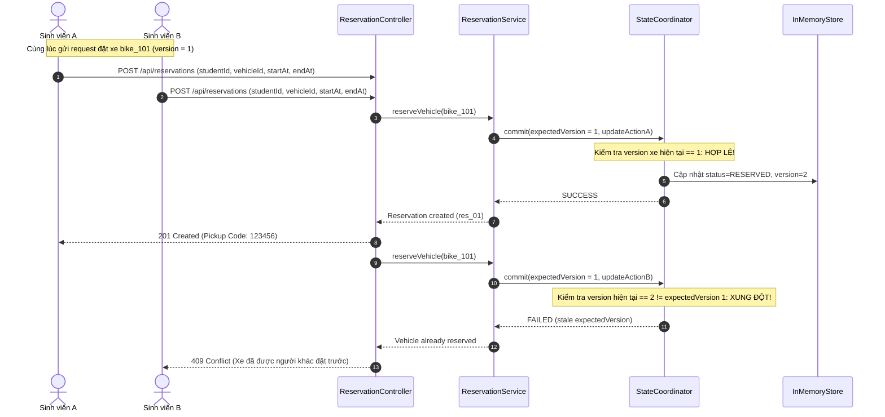
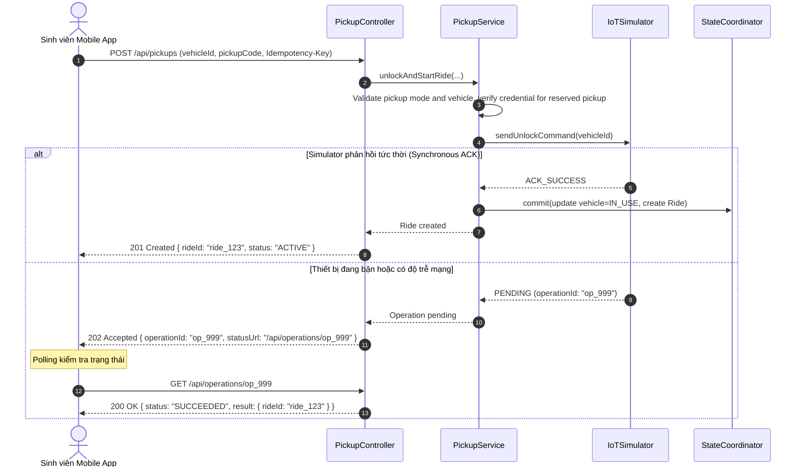

# 02 — Architecture & System Design

Tài liệu này mô tả kiến trúc tổng thể, cấu trúc module, phân quyền sở hữu dữ liệu (Data Ownership), luồng xử lý đồng thời (Concurrency Control), và các quy tắc phụ thuộc (Dependency Rules) của hệ thống **Smart E-Mobility Hub Backend**.

---

## 1. Phong Cách Kiến Trúc Tổng Thể (Architectural Style)

Hệ thống được thiết kế theo mô hình **Monolithic 3-tier Layered Architecture** (Controller → Service → Domain/Store) chạy trên **Java 21 LTS** và **Spring Boot 4.1.2**:
- **Single-instance Process:** Chạy gọn gàng trong 1 tiến trình máy ảo Java duy nhất, dễ dàng kiểm thử và triển khai mà không phụ thuộc vào hạ tầng cloud hay cụm server phức tạp.
- **In-Memory Primary Data Store:** Toàn bộ dữ liệu trạng thái mạng lưới (Hubs, Vehicles, Spaces, Ports, Reservations, Rides, Accounts) được duy trì trong bộ nhớ RAM bằng các cấu trúc thread-safe `ConcurrentHashMap`.
- **Atomic Snapshot File Persistence:** Mỗi khi có một giao dịch thay đổi trạng thái hợp lệ, hệ thống ghi snapshot đồng bộ trước khi báo commit thành công; ưu tiên Atomic Move xuống file snapshot đĩa cứng `data/data.json`.
- **In-Process IoT Simulator:** Module giả lập IoT chạy trên background threads bên trong cùng tiến trình Java, liên tục cập nhật dữ liệu đo xa và phản hồi các lệnh phần cứng (khóa/mở xe).

---

## 2. Sơ Đồ Kiến Trúc Hệ Thống (Mermaid Diagrams)

### 2.1. C4 Container & Thành Phần Hệ Thống

```mermaid
graph TD
    subgraph Client Apps
        MobileApp["Mobile App (Sinh viên)<br/>Vue.js / React Native"]
        WebConsole["Web Console (Operator)<br/>React / TypeScript Desktop"]
    end

    subgraph Spring Boot Monolith
        subgraph REST API Layer
            AuthController["AuthController (UC-00)"]
            StudentController["Student Flow Controllers<br/>(UC-01 - UC-07)"]
            OperatorController["Operator Flow Controllers<br/>(UC-08 - UC-14)"]
        end

        subgraph Service Layer
            AuthService["Auth & Session Service"]
            HubService["Hub & Search Service"]
            RideService["Reservation & Ride Service"]
            ChargingService["Smart Charging Service"]
            OperatorService["Network Monitoring & Rebalancing"]
            SimService["What-if Simulation Engine"]
        end

        subgraph Core & Storage Layer
            StateCoordinator["StateCoordinator<br/>(Optimistic Locking Engine)"]
            InMemoryStore["InMemoryDataStore<br/>(ConcurrentHashMaps)"]
            JsonStore["JsonStore<br/>(Atomic File Persistence)"]
        end

        subgraph Background & Simulation
            JobScheduler["JobScheduler<br/>(15m Expiry, Overload Checks)"]
            IoTSimulator["In-Process IoT Simulator<br/>(Vehicle Telemetry, Lock ACK)"]
        end
    end

    subgraph Physical Storage
        DataJson[("data/data.json<br/>Snapshot on Disk")]
    end

    MobileApp -->|HTTPS / REST JSON| StudentController
    MobileApp -->|HTTPS / REST JSON| AuthController
    WebConsole -->|HTTPS / REST JSON| OperatorController
    WebConsole -->|HTTPS / REST JSON| AuthController

    StudentController --> Service Layer
    OperatorController --> Service Layer
    AuthController --> AuthService

    Service Layer --> StateCoordinator
    StateCoordinator --> InMemoryStore
    StateCoordinator --> JsonStore
    JsonStore --> DataJson

    JobScheduler --> Service Layer
    IoTSimulator <-->|In-Memory Bus| Service Layer
```

---

## 3. Phân Rã Module & Trách Nhiệm (Module Breakdown)

Cấu trúc package của backend được chia tách rõ ràng:

```
src/main/java/bku/emobility/
├── common/
│   ├── domain/       # POJO Entities, Enums, Domain Exceptions, Pure Invariants
│   └── store/        # InMemoryDataStore, JsonStore, StateCoordinator
├── controller/       # REST API Endpoints, Request/Response DTOs, Exception Handlers
├── service/          # Nghiệp vụ use case, điều phối giao dịch qua StateCoordinator
├── iot/              # In-Process IoT Simulator, Command Dispatcher, Telemetry Generator
├── scheduler/        # Background Scheduled Tasks (quá hạn 15p, cảnh báo trạm)
└── config/           # Cấu hình Spring Boot, CORS, Bean wiring
```

### Thành phần trong luồng sinh viên

- [UC-01](plans/feature-uc01-search-hubs.md) — `SearchController` → `HubSearchService`. Tìm Hub, lọc xe qua Vehicle.isSearchable.
- [UC-02](plans/feature-uc02-vehicle-detail.md) — `VehicleDetailsController` → `VehicleLookupService`. Kết hợp Vehicle với số đo thiết bị và làm mới xe vừa được đặt.
- [UC-03](plans/feature-uc03-reserve-vehicle.md) — `BookingController` → `ReservationService`. Giữ Vehicle và tạo Reservation trong một commit.
- [UC-04](plans/feature-uc04-parking-reservation.md) — `ParkingController` → `ParkingReservationService`. Giữ đúng ParkingSpace trong khung giờ yêu cầu.
- [UC-05](plans/feature-uc05-pickup-qr.md) — `PickupController` → `VehiclePickupService`. Sau ACK mở khóa, tạo Ride một lần cho cả hai nhánh nhận xe.
- [UC-06](plans/feature-uc06-return-vehicle.md) — `ReturnController` → `VehicleReturnService`. Đối chiếu LockConfirmation trước khi hoàn tất Ride.
- [UC-07](plans/feature-uc07-charging-booking.md) — `ChargingController` → `ChargingRequestService`. Kiểm tra cổng, công suất và phân bổ khoảng sạc.

### Chi tiết trách nhiệm:
1. **`common/domain`:**
   - Sở hữu: Định nghĩa các thực thể (`Account`, `Vehicle`, `MobilityHub`, `ParkingSpace`, `Reservation`, `Ride`, `ChargingPort`, `DispatchOrder`, `Incident`), Enums, và logic tính toán nội tại của thực thể.
   - Nguyên tắc: **Pure Java thuần túy**. Không phụ thuộc vào Spring Web, không phụ thuộc vào Controllers hay Stores.
2. **`common/store`:**
   - Sở hữu: `InMemoryDataStore` (chứa các `ConcurrentHashMap`), `JsonStore` (serialize/deserialize JSON an toàn), và `StateCoordinator` (kiểm tra `expectedVersion` và commit nguyên tử).
   - Nguyên tắc: Cung cấp API atomic read/write; không chứa logic nghiệp vụ đặc thù của từng use case.
3. **`service`:**
   - Sở hữu: Triển khai toàn bộ luồng xử lý của 16 Use Cases. Thực hiện kiểm tra tính hợp lệ, gọi IoT Simulator khi cần, và gọi `StateCoordinator.commit(...)` để ghi nhận thay đổi.
4. **`controller`:**
   - Sở hữu: Nhận HTTP requests, validate định dạng đầu vào (JSR-303 / Bean Validation), ánh xạ Header token, gọi Service tương ứng, và format HTTP Response hoặc Error Response chuẩn.
   - Nguyên tắc: **Không chứa business rules**. Không tự quyết định xem xe có đủ điều kiện thuê hay không.
5. **`iot` (In-Process Simulator):**
   - Sở hữu: Trình giả lập các thiết bị xe và cảm biến trạm. Định kỳ phát sinh dữ liệu đo xa (`batteryPct`, GPS, `lockStatus`) và mô phỏng phản hồi lệnh điều khiển từ xa có trễ mạng giả lập.
6. **`scheduler`:**
   - Sở hữu: Các tiến trình định kỳ (`@Scheduled`) quét tìm các đơn đặt xe/chỗ đỗ quá hạn 15 phút để hủy và kiểm tra ngưỡng quá tải mạng lưới.

---

## 4. Luồng Dữ Liệu & Kiểm Soát Đồng Thời (Data Flow & Concurrency Control)

### 4.1. Cơ chế Kiểm soát Đồng thời Lạc quan (Optimistic Concurrency Control)
Hệ thống không sử dụng khóa bi quan (Pessimistic DB Locks) để tránh tắc nghẽn hiệu năng. Thay vào đó, mỗi thực thể có trường số nguyên `version`.



### 4.2. Luồng Lệnh IoT Bất đồng bộ (Asynchronous IoT Command & ACK Flow)

Khi mở khóa xe (UC-05) hoặc can thiệp từ xa (UC-09):



### 4.3. Cơ chế Lưu trữ File Snapshot Nguyên tử (Atomic Persistence)
- Khi `StateCoordinator` commit thành công vào RAM:
  1. Chuẩn bị snapshot dữ liệu hiện tại dưới dạng chuỗi JSON.
  2. Ghi chuỗi JSON ra file tạm: `data/data.json.tmp`.
  3. Thực hiện thao tác đổi tên file nguyên tử của hệ điều hành (`Files.move(..., StandardCopyOption.ATOMIC_MOVE)`): thay thế `data/data.json` bằng file tạm.
  4. Nếu hệ thống file hỗ trợ `ATOMIC_MOVE`, snapshot cũ không bị ghi cụt dở khi tiến trình gián đoạn. Nếu không hỗ trợ, `JsonStore` dùng `REPLACE_EXISTING`; fallback có bảo đảm yếu hơn và lỗi vẫn được ném ra để coordinator rollback RAM/version.

---

## 5. Quyền Sở Hữu Dữ Liệu (Data Ownership)

| Tập dữ liệu | Module sở hữu logic | Quyền truy cập ghi | Nguồn sự thật (Source of Truth) |
|---|---|---|---|
| Tài khoản & Phiên đăng nhập | AuthService / SessionService | Qua service và StateCoordinator | InMemoryDataStore và JSON snapshot |
| Trạm & Vị trí đỗ & Cổng sạc | `HubService` / `OperatorService` | Chỉ Operator hoặc Hệ thống | In-Memory `ConcurrentHashMap` |
| Phương tiện (`Vehicle`) | `RideService` / `IoTSimulator` | Qua `StateCoordinator` | In-Memory `VehicleRegistry` |
| Đặt xe & Chuyến đi | `RideService` | Qua `StateCoordinator` | In-Memory `ReservationRegistry` |
| Dữ liệu đo xa (`Telemetry`) | `IoTSimulator` | Tự động ghi từ Simulator ticks | In-Memory Telemetry Cache |
| Cảnh báo mạng lưới (`Alerts`) | `OperatorService` / `JobScheduler` | Scheduler & Event Bus | In-Memory Alert List |
| Kịch bản giả lập (`What-if`) | `SimService` | Cô lập trong Ram Session | Không ghi ra đĩa |

---

## 6. Ma Trận Quy Tắc Phụ Thuộc (Allowed & Forbidden Dependencies)

Để giữ cho kiến trúc trong sạch và dễ kiểm thử, mọi thành viên và Agent phải tuân thủ nghiêm ngặt các quy tắc phụ thuộc:

```
[Controller] ───────────► [Service] ───────────► [Domain / Store]
     ▲                         ▲                          ▲
     │                         │                          │
(Allowed)                  (Allowed)                  (Allowed)
```

### Các điều cấm kỵ (Forbidden):
- ❌ **Không cho phép Controller truy cập trực tiếp Store:** Controller không được `import bku.emobility.common.store.*` để đọc/ghi dữ liệu, bắt buộc phải thông qua `Service`.
- ❌ **Không cho phép Domain phụ thuộc vào Spring Web hay Store:** `common/domain` phải là Java thuần, không chứa annotations của HTTP Controller.
- ❌ **Không cho phép Service trực tiếp xử lý HTTP Objects:** Service không được nhận `HttpServletRequest`, `HttpServletResponse`, hay `HttpSession`.
- ❌ **Không cho phép Simulator gọi trực tiếp Controller:** Simulator chỉ giao tiếp với Service thông qua Event Bus hoặc callback interface nội bộ.

## HTTP authentication và authorization của UC-00

Runtime hiện tại theo pom.xml là Spring Boot 4.1.2 và Java 21.

Luồng request: CorsFilter → BearerSessionFilter → SecurityFilterChain authorization → Controller → Service → Store.
SessionService sở hữu xác thực/gia hạn/thu hồi phiên; AuthService sở hữu đăng ký/đăng nhập.
Các mutation session đều qua StateCoordinator. Cookie hoặc HTTP session không xác thực caller.

CurrentAccount là principal nội bộ theo request. Controller trả CurrentAccountResponseDTO riêng.
Role/status đọc từ Account hiện hành; session hash không nằm trong response identity.
ApiErrors tạo cùng error envelope cho MVC advice và các filter; SecurityErrorWriter ghi JSON từ filter.

Route role guard kiểm soát STUDENT/OPERATOR. Owner của tài nguyên phải được xác minh từ Store bởi service sở hữu tài nguyên.
Repo hiện có AccountController, ownership được kiểm chứng ở me/logout. Các endpoint Student/Operator nghiệp vụ được ghép theo module của M1/M2.
Fixture kiểm tra role route chỉ được import trong AuthSecurityIntegrationTest.

CSRF bị tắt cho cơ chế Authorization Bearer không dùng cookie tự gửi. Nếu chuyển sang cookie authentication phải xem lại chính sách này.
