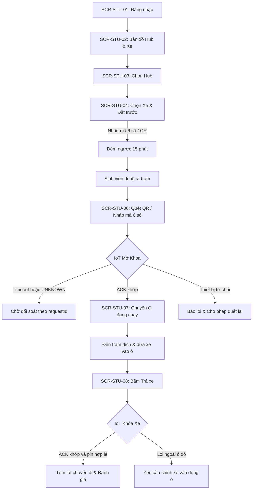

# 05 — UI Flow & Screen Specifications

Tài liệu này đặc tả luồng trải nghiệm người dùng (User Flows), danh mục màn hình giao diện (Screen Catalog), các trạng thái UI (Loading, Empty, Error, Active), và bảng ánh xạ giữa Giao diện và API Backend, dựa trên hồ sơ thiết kế Submission #2 (`Phase2_A01_7.pdf`).

---

## 1. Phân Hệ Sinh Viên — Mobile UI (Student App)

Ứng dụng di động dành cho Sinh viên được tối ưu cho thao tác một tay trên màn hình cảm ứng dọc.

### 1.1. Danh mục Màn hình (Mobile Screen Catalog)

| Mã màn hình | Tên màn hình | Mục đích & Mô tả | Use Case liên quan |
|---|---|---|:---:|
| `SCR-STU-01` | Đăng nhập & Đăng ký | Xác thực sinh viên qua email trường `@hcmut.edu.vn`. | UC-00 |
| `SCR-STU-02` | Bản đồ Tìm kiếm Hub & Xe | Bản đồ tương tác hiển thị vị trí các Hub lân cận, số xe khả dụng. | UC-01 |
| `SCR-STU-03` | Chi tiết Hub & Danh sách Xe | Danh sách xe tại trạm được chọn; hiển thị mã xe, mức pin, trạng thái và khoảng cách đến Hub. | UC-01, UC-02 |
| `SCR-STU-04` | Chi tiết Xe & Đặt trước | Hiển thị thông số xe, nút "Đặt trước 15 phút", đồng hồ đếm ngược và mã PIN/QR nhận xe. | UC-02, UC-03 |
| `SCR-STU-05` | Đặt chỗ đỗ xe tại Hub đích | Chọn trạm đến và giữ trước vị trí đỗ trước khi bắt đầu di chuyển. | UC-04 |
| `SCR-STU-06` | Quét QR / Nhập mã Nhận xe | Giao diện mở camera quét mã QR trên xe hoặc bàn phím nhập mã 6 số để mở khóa xe. | UC-05 |
| `SCR-STU-07` | Chuyến đi Đang diễn ra | Hiển thị thời gian đã đi, dung lượng pin xe theo thời gian thực và nút "Trả xe". | UC-05, UC-06 |
| `SCR-STU-08` | Trả xe & Hoàn tất chuyến đi | Xác nhận vị trí trạm và ô đỗ trả xe, hiển thị tóm tắt hành trình và mức pin tiêu thụ. | UC-06 |
| `SCR-STU-09` | Đăng ký Sạc xe cá nhân | Chọn Hub, đặt mức pin mong muốn và khung giờ sạc cho xe riêng. | UC-07 |

---

### 1.2. Luồng Nghiệp vụ Điển Hình của Sinh Viên (Student Journey Flow)

---

## 2. Phân Hệ Vận Hành — Desktop Web Console (Operator)

Giao diện Web trên máy tính bàn hoặc laptop dành cho Nhân viên Trung tâm Điều phối Vận hành VNU-HCM.

### 2.1. Danh mục Màn hình (Operator Screen Catalog)

| Mã màn hình | Tên màn hình | Mục đích & Mô tả | Use Case liên quan |
|---|---|---|:---:|
| `SCR-OPR-01` | Dashboard Tổng quan Mạng lưới | Tổng hợp KPI toàn mạng lưới: tổng xe, xe đang thuê, xe pin yếu, trạm cảnh báo. | UC-08 |
| `SCR-OPR-02` | Bản đồ Giám sát Telemetry Thời gian thực | Bản đồ địa không gian hiển thị vị trí toàn bộ xe, trạm, chỉ báo chất lượng dữ liệu đo xa (`FRESH`/`STALE`/`MISSING`). | UC-08 |
| `SCR-OPR-03` | Trung tâm Cảnh báo Quá tải & Sự cố | Bảng thông báo danh sách trạm quá tải ($\ge 85\%$) hoặc thiếu xe ($\le 2$), các báo cáo hư hỏng. | UC-10, UC-12 |
| `SCR-OPR-04` | Bảng Can thiệp Điều khiển Từ xa | Bảng điều khiển cho phép Operator khóa khẩn cấp, mở khóa bảo dưỡng, hoặc ngắt thiết bị vào chế độ `MAINTENANCE`. | UC-09 |
| `SCR-OPR-05` | Quản lý Điều phối & Luân chuyển Xe | Khởi tạo lệnh điều phối (Dispatch Order), chỉ định xe tải gom xe từ trạm thừa sang trạm thiếu. | UC-11 |
| `SCR-OPR-06` | Bộ Lập lịch Sạc Thông minh | Phân bổ cổng sạc tự động hoặc thủ công, ưu tiên nhóm xe pin $< 20\%$ vào giờ thấp điểm điện lưới. | UC-13 |
| `SCR-OPR-07` | Studio Mô phỏng Kịch bản Giả lập | Giao diện nạp thông số giả lập (What-if scenario), chạy thử nghiệm kịch bản giờ tan tầm hoặc sự cố trạm. | UC-14 |

---

## 3. Các Trạng Thái Giao Diện Tiêu Chuẩn (Standard UI States)

Mọi màn hình trên cả Mobile App và Web Console bắt buộc phải xử lý đầy đủ 4 trạng thái giao diện:

1. **Loading State (Đang tải):**
   - Mobile: Hiển thị hiệu ứng Skeleton Loader hoặc vòng quay chỉ báo rõ ràng; vô hiệu hóa nút bấm hành động để tránh double-tap.
   - Operator: Hiển thị thanh tiến trình hoặc mờ nhẹ bảng dữ liệu trong khi fetch dữ liệu định kỳ 5 giây một lần.
2. **Empty State (Dữ liệu rỗng):**
   - Ví dụ: Tìm kiếm không có hub nào trong bán kính $\rightarrow$ Hiển thị hình minh họa trạm xe kèm thông điệp: *"Không tìm thấy trạm nào trong bán kính đã chọn. Bạn hãy thử mở rộng bán kính tìm kiếm."*
   - Ví dụ: Không có cảnh báo quá tải nào $\rightarrow$ Hiển thị: *"Tất cả các trạm đang hoạt động cân bằng và ổn định."*
3. **Error State (Trạng thái lỗi):**
   - Mất kết nối mạng: Hiển thị banner đỏ trên đầu màn hình: *"Không thể kết nối máy chủ. Vui lòng kiểm tra đường truyền."* kèm nút "Thử lại".
   - Vi phạm nghiệp vụ (mã lỗi từ backend): Hiển thị đúng `error.message` từ API JSON chuẩn; không bao giờ hiển thị mã lỗi kỹ thuật 500 hay chuỗi exception thô.
4. **Active / Success State (Trạng thái bình thường/thành công):**
   - Dữ liệu hiển thị trực quan; thông báo toast màu xanh lá cây khi thao tác (đặt xe, trả xe, tạo lệnh) thành công.

---

## 4. Bảng Ánh Xạ Màn Hình và API Backend (UI-to-API Mapping)

| Mã màn hình | Hành động của người dùng | HTTP Method & Endpoint | Payload tóm tắt | Dữ liệu cập nhật lên UI |
|---|---|---|---|---|
| `SCR-STU-01` | Bấm "Đăng nhập" | `POST /api/auth/login` | `{ email, password }` | Lưu `sessionToken`, điều hướng sang bản đồ. |
| `SCR-STU-02` | Mở app / Di chuyển bản đồ | `POST /api/search/hubs` | `{ origin: { latitude, longitude }, radiusKm }` | Vẽ các Marker Hub và số xe lên bản đồ. |
| `SCR-STU-03` | Chọn một xe trong danh sách Hub | `GET /api/vehicles/{id}` | Không | Hiển thị trạng thái và số đo của xe đã chọn. |
| `SCR-STU-04` | Nhấn "Đặt trước xe này" | `POST /api/reservations` | `{ vehicleId, startsAt, endsAt }` | Hiển thị mã 6 số + QR và đồng hồ đếm ngược 15p. |
| `SCR-STU-04` | Nhấn "Hủy đặt xe" | `POST /api/reservations/{id}/cancel` | Không | Reset về trạng thái chưa đặt, xe được đánh giá lại điều kiện cho thuê. |
| `SCR-STU-05` | Đặt chỗ đỗ trước | `POST /api/parking-reservations` | `{ hubId, spaceId, startsAt, endsAt }` | Lưu vé đỗ xe điện tử vào hồ sơ cá nhân. |
| `SCR-STU-06` | Quét QR hoặc nhập mã mở | `POST /api/pickups` | `{ vehicleId, reservationId, pickupCode } hoặc { vehicleId }` + `Idempotency-Key` | Mở chuyến khi có ACK khớp. Timeout hiển thị chờ đối soát. |
| `SCR-STU-08` | Nhấn "Xác nhận trả xe" | `POST /api/rides/{id}/return` | `{ hubId, spaceId }` + `Idempotency-Key` | Hiển thị kết quả sau ACK đúng lệnh, đúng xe, đúng ô và có pin cuối. |
| `SCR-STU-09` | Gửi yêu cầu sạc | `POST /api/charging-requests` | `{ vehicleId, hubId, targetBatteryPct, requestedStartAt }` | Báo giờ sạc và số cổng sạc đã xếp chỗ. |
| `SCR-OPR-01` | Mở Dashboard Vận hành | `GET /api/operator/network-report` | Không | Cập nhật các Cards KPI và biểu đồ tỷ lệ chiếm dụng. |
| `SCR-OPR-03` | Xem danh sách cảnh báo | `GET /api/operator/alerts` | `?severity=CRITICAL` | Danh sách các trạm đỏ quá tải $\ge 85\%$. |
| `SCR-OPR-04` | Khóa xe khẩn cấp | `POST /api/operator/interventions` | `{ resourceType: "VEHICLE", resourceId, action: "FORCE_LOCK" }` | Cập nhật icon xe thành màu đỏ bị khóa. |
| `SCR-OPR-05` | Bấm tạo lệnh điều phối | `POST /api/operator/dispatch-orders` | `{ sourceHubId, destinationHubId, vehicleIds }` | Trừ xe trạm nguồn, xe chuyển sang trạng thái `IN_TRANSIT`. |
| `SCR-OPR-07` | Chạy kịch bản What-if | `POST /api/operator/simulations` | `{ scenarioName, parameters }` | Biểu đồ dự báo quá tải trong 2 giờ tới (snapshot). |

